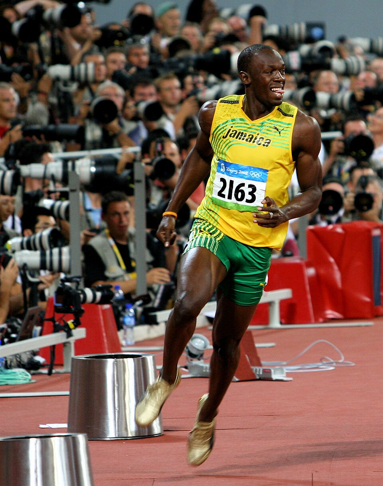

```{r}
#| label: setup
#| include: false
library(readr)
library(dplyr)
library(tidyr)
library(ggplot2)
source("R/theme_goat.R")   # chart colours and theme, shared with custom.scss

# "Usain BOLT" -> "Usain Bolt" for display
pretty_name <- function(x) gsub("(^|[\\s-])(\\p{L})", "\\1\\U\\2", tolower(x), perl = TRUE)

scores   <- read_csv("data/processed/scores.csv",   show_col_types = FALSE) |>
  mutate(Competitor = pretty_name(Competitor))
rankings <- read_csv("data/processed/rankings.csv", show_col_types = FALSE) |>
  mutate(Competitor = pretty_name(Competitor))
robust   <- read_csv("data/processed/robustness.csv", show_col_types = FALSE) |>
  mutate(Competitor = pretty_name(Competitor))

best_race <- rankings |> filter(ranking == "best_race")
career    <- rankings |> filter(ranking == "career")

n_finals_total <- n_distinct(paste(scores$year, scores$competition))
n_scored       <- nrow(scores)
n_runners      <- n_distinct(scores$Competitor)
top_career     <- career |> slice(1)
top_race       <- best_race |> slice(1)
bolt08 <- scores |> filter(year == 2008, place == 1)
bolt09 <- scores |> filter(year == 2009, place == 1)
n_ann  <- sum(career$has_annulled[1:10])

winners <- scores |>
  group_by(year, competition) |>
  slice_max(score, n = 1, with_ties = FALSE) |>
  ungroup()
r_trend <- cor(winners$year, winners$score)

# Robustness: how many specifications put each runner first / in the top 2?
n_specs  <- n_distinct(robust$spec)
top_wins <- robust |> filter(Competitor == top_career$Competitor)
n_first  <- sum(top_wins$rank == 1)
n_top2   <- sum(top_wins$rank <= 2)
leaders  <- robust |> filter(rank == 1, Competitor != top_career$Competitor)

fmt <- function(x) sprintf("%.2f", x)
```

```{r}
#| label: board
#| output: asis
#| echo: false
# The results board: top five careers, set like a stadium scoreboard.
board <- career |> slice_head(n = 5)
rows <- sprintf(
  '<tr><td class="pos">%d</td><td class="who">%s%s</td><td class="nat">%s</td><td class="num">%s</td><td class="num">%d</td></tr>',
  board$rank, board$Competitor, ifelse(board$has_annulled, "&#8202;*", ""),
  board$Nat, fmt(board$mean_score), board$n_finals)
cat(
  '<div class="board" role="region" aria-label="Career dominance, top five">',
  '<p class="board-title">Career dominance in Olympic and World Championship finals, 1968–2025</p>',
  '<table><thead><tr><th scope="col">Rank</th><th scope="col">Athlete</th><th scope="col">Nation</th>',
  '<th scope="col" class="num">Mean score</th><th scope="col" class="num">Finals</th></tr></thead><tbody>',
  rows,
  '</tbody></table>',
  sprintf('<p class="board-note">%s is first under %d of %d ways of scoring and in the top two under all %d. Removing doping-annulled runs puts %s first; a median-based score puts %s first. * Includes results later annulled for doping.</p>',
          top_career$Competitor, n_first, n_specs, n_top2,
          leaders$Competitor[leaders$spec == "Annulled runs removed"],
          leaders$Competitor[leaders$spec == "Median / MAD"]),
  '</div>', sep = "\n")
```

```{r}
#| label: fig-hero
#| fig-cap: "Raw time against era-adjusted rank. Left: the ten best careers by dominance, ordered by their average finishing time, with each runner's rank by average time among all 60 athletes with two or more finals. Right: the same runners ordered by mean dominance score. Blue lines rank higher once race conditions and era are removed. * Includes results later annulled for doping."
#| fig-alt: "Slope chart of the ten best careers. Usain Bolt is first by both average time and dominance. Valeriy Borzov moves from the slowest average time of the ten to fourth by dominance, and Carl Lewis from ninth of the ten to second. Kishane Thompson, Fred Kerley and Noah Lyles, the fastest by raw time after Bolt, fall to eighth, ninth and tenth."
#| fig-width: 8
#| fig-height: 5.6
# Raw rank: every career (2+ finals) ranked by average finishing time.
raw <- scores |>
  group_by(Competitor) |>
  summarise(mean_time = mean(time), n = n(), .groups = "drop") |>
  filter(n >= 2) |>
  mutate(raw_rank = rank(mean_time, ties.method = "min"))

hero <- career |>
  slice_head(n = 10) |>
  left_join(raw, by = "Competitor") |>
  mutate(
    label    = paste0(Competitor, if_else(has_annulled, " *", "")),
    raw_pos  = rank(raw_rank, ties.method = "first"),  # order among these ten
    adj_pos  = rank,
    move     = case_when(adj_pos < raw_pos ~ "Ranks higher once era is removed",
                         adj_pos > raw_pos ~ "Ranks lower once era is removed",
                         TRUE              ~ "Same position")
  )

ggplot(hero) +
  geom_segment(aes(x = 0, xend = 1, y = raw_pos, yend = adj_pos, colour = move),
               linewidth = 1.1, lineend = "round") +
  geom_point(aes(x = 0, y = raw_pos, colour = move), size = 2.6) +
  geom_point(aes(x = 1, y = adj_pos, colour = move), size = 2.6) +
  geom_text(aes(x = -0.04, y = raw_pos,
                label = paste0(label, "  ", sprintf("%.2fs", mean_time), "  #", raw_rank)),
            hjust = 1, size = 3.6, colour = goat_cols[["ink"]]) +
  geom_text(aes(x = 1.04, y = adj_pos, label = paste0(adj_pos, "  ", label)),
            hjust = 0, size = 3.6, colour = goat_cols[["ink"]]) +
  annotate("text", x = 0, y = 0.2, label = "By average time", fontface = "bold",
           size = 3.8, colour = goat_cols[["ink"]]) +
  annotate("text", x = 1, y = 0.2, label = "By dominance score", fontface = "bold",
           size = 3.8, colour = goat_cols[["ink"]]) +
  scale_colour_manual(values = c("Ranks higher once era is removed" = goat_cols[["track"]],
                                 "Ranks lower once era is removed"  = goat_cols[["grey"]],
                                 "Same position"                     = goat_cols[["ink"]])) +
  scale_y_reverse() +
  scale_x_continuous(limits = c(-1.15, 1.75)) +
  theme_goat() +
  theme(axis.text = element_blank(), axis.title = element_blank(),
        panel.grid.major.y = element_blank())
```

## At a Glance {.unnumbered}

::: {.glance}
<dl>
<dt>Question</dt>
<dd>Which men's 100m sprinter most dominated the runners in their own race? Not who ran fastest, but who beat the field by the most.</dd>
<dt>Method</dt>
<dd>A leave-one-out z-score inside each final: how many standard deviations a runner finished ahead of everyone else in that race. Like a fixed effect, it cancels wind, altitude, track and era. It does not control for field strength.</dd>
<dt>Finding</dt>
<dd>`r top_career$Competitor` ranks first on career dominance (mean `r fmt(top_career$mean_score)` across `r top_career$n_finals` finals) and on single-race dominance (`r top_race$competition` `r top_race$year`, `r fmt(top_race$score)`). He is first under `r n_first` of `r n_specs` scoring choices and never lower than second (@sec-robust).</dd>
<dt>Caveat</dt>
<dd>Most careers span two to six finals, so career averages carry wide uncertainty. Below first place the order moves with the scoring choice (@sec-limits).</dd>
</dl>
<p class="facts">`r n_finals_total` finals, `r n_scored` scored performances and `r n_runners` athletes. Olympic Games 1968–2024, World Championships 1983–2025.</p>
:::

::: {.link-row}
[Code and data on GitHub](https://github.com/etd2122/100m-goat){.btn .btn-primary role="button" target="_blank"} [Original Athens presentation](https://docs.google.com/presentation/d/15JcPSdAi1Mbq-asNEOIS1xl9LPjafGVmoq-BmM_cRKI){.btn .btn-outline-secondary role="button" target="_blank"} [LinkedIn](https://www.linkedin.com/in/emelia-davis){.btn .btn-outline-secondary role="button" target="_blank"}
:::

## Data

### Sample

The sample covers every men's 100m final at the Olympic Games from 1968, the first Games with fully automatic timing, and at the World Athletics Championships from their inception in 1983: `r n_finals_total` finals in total. The final analysis scores `r n_scored` performances by `r n_runners` athletes.

### Sources

The primary source is the World Athletics all-time performance list [@worldathletics], accessed through an open-source compilation [@camminady]. This source has two gaps. It includes only marks of 10.30 seconds or faster, so the slowest finalists in older finals are missing, and it ends in July 2023, so the 2023, 2024 and 2025 championships are missing. I filled these gaps by hand-entering 61 records from official results, with a source link attached to every record (`data/raw/supplement.csv`).

### Construction and validation

I identified finals by matching championship final dates to finishing-position codes. Automated checks confirm that every final has a complete field (eight entrants, or nine at Beijing 2015, which used nine lanes), that no athlete appears twice in a final, and that every time is numeric. These checks caught real errors. The 2003 World Championships final was first assigned to the wrong date, and a minor meet elsewhere shared the date of the 2007 final. On each date, I keep only the venue with the most finishers and report anything the rule removes.

## Methodology {#sec-methods}

### The dominance score

For runner $i$ in final $r$, let $t_{ir}$ be their time, and let $\bar t_{-i,r}$ and $s_{-i,r}$ be the mean and standard deviation of the other finishers' times. The dominance score is

$$
D_{ir} = \frac{\bar t_{-i,r} - t_{ir}}{s_{-i,r}}
$$ {#eq-score}

A positive score means the runner beat the rest of the field; a score of 3 means they finished three standard deviations ahead of it. I leave each runner out of their own comparison so a dominant winner cannot pull the field's average toward themselves or inflate its spread. In other words, @eq-score measures exactly what the ancient Greeks valued: how far you beat the people next to you.

### Identification: an omitted-variable-bias perspective

The naive way to rank sprinters is by raw time, which amounts to the regression

$$
\text{Time}_{ir} = \beta_0 + \beta_1 \text{Runner}_i + u_{ir}
$$ {#eq-naive}

The error term $u_{ir}$ holds the race conditions this regression leaves out: wind, altitude, track surface, footwear technology and era. Leaving them out produces omitted variable bias, because both conditions for OVB hold [@stock2019]. These factors determine finishing times, and they are correlated with the regressor, since who ran is tied to when and where they ran. As a result, $\hat\beta_1 \xrightarrow{p} \beta_1 + \rho_{Xu}\,\sigma_u / \sigma_X$ with $\rho_{Xu} \neq 0$, and raw-time rankings are biased toward whoever raced in the best conditions. This is the "compared to when?" problem, written as an equation.

The dominance score removes this bias the same way fixed effects do. I decompose each time into a race effect, a runner effect and noise:

$$
t_{ir} = \alpha_r + \theta_i + \varepsilon_{ir}
$$ {#eq-decomp}

where $\alpha_r$ captures everything shared by every runner in race $r$. The numerator of @eq-score becomes

$$
\bar t_{-i,r} - t_{ir} = \left(\bar\theta_{-i} - \theta_i\right) + \left(\bar\varepsilon_{-i,r} - \varepsilon_{ir}\right)
$$ {#eq-diff}

so the race effect $\alpha_r$ cancels exactly, just as entity fixed effects remove time-invariant omitted variables in panel data. Dividing by $s_{-i,r}$ puts every race on the same scale.

@eq-diff also shows what the score cannot remove. It still depends on $\bar\theta_{-i}$, the ability of everyone else in the race. **Field strength is an omitted variable the score cannot control for.** This is the "compared to who?" problem, and no within-race measure can fully solve it.

### Choices behind the number

Each of the following is a judgment, not a measurement, and I state my reasoning for each.

- **Doping-annulled performances** (Ben Johnson 1987 and 1988; Tim Montgomery 2001 and 2003; Dwain Chambers 2003; Tyson Gay 2012) are kept and flagged. These athletes were in the race, and the race everyone else ran included them.
- **Injured finishers** (Pierfrancesco Pavoni 1987, 16.23s; Ray Stewart 1988, 12.26s; Nesta Carter 2011, 10.95s; Asafa Powell 2012, 11.99s) are excluded from field statistics. Their times reflect injury, not ability, and including them would inflate $s_{-i,r}$ and shrink everyone else's score. Carter's injury is not recorded in the source; I reclassified him because he finished 0.68 seconds behind sixth place.
- **Disqualified and non-finishing athletes** have no time and are not scored.
- **Career rankings** average each athlete's scores and require at least two finals, so one great race cannot top a career list. I did not raise the minimum to three: before 1983 there was only one championship final every four years, so a three-final rule would exclude every athlete who debuted before then. @sec-robust shows the three-final ranking.

## Results

### Single-race dominance

@fig-best-race shows each athlete's most dominant final. `r top_race$Competitor`'s win at the `r top_race$year` `r top_race$competition` is the most dominant performance in the sample (score `r fmt(top_race$score)`), followed by `r best_race$Competitor[2]` (`r best_race$year[2]`, `r fmt(best_race$score[2])`) and `r best_race$Competitor[3]` (`r best_race$year[3]`, `r fmt(best_race$score[3])`).

<!-- PASTE YOUR BOLT IMAGE LINE ON THE LINE BELOW -->
{fig-alt="Usain Bolt in celebration about 1 or 2 seconds after his 100m victory at Beijing Olympics 2008, breaking the world record." width="65%" fig-align="center"}


```{r}
#| label: fig-best-race
#| fig-cap: "Each athlete's single most dominant championship final (top 15). Grey bars indicate results later annulled for doping."
#| fig-alt: "Horizontal bar chart of the 15 most dominant single finals, led by Usain Bolt at Beijing 2008."
#| fig-width: 8
#| fig-height: 5.6
top15 <- best_race |>
  slice_head(n = 15) |>
  mutate(
    label = factor(paste0(Competitor, " (", year, ")"),
                   levels = rev(paste0(Competitor, " (", year, ")"))),
    flag  = if_else(status == "annulled", "Result later annulled", "Official result")
  )

ggplot(top15, aes(x = score, y = label, fill = flag)) +
  geom_col(width = 0.72) +
  geom_text(aes(label = fmt(score)), hjust = -0.15, size = 3.3,
            colour = goat_cols[["ink"]]) +
  scale_fill_manual(values = c("Official result"       = goat_cols[["ink"]],
                               "Result later annulled" = goat_cols[["grey"]])) +
  scale_x_continuous(expand = expansion(mult = c(0, 0.08))) +
  labs(x = "Dominance score (standard deviations ahead of the field)", y = NULL) +
  theme_goat() +
  theme(panel.grid.major.y = element_blank(),
        panel.grid.major.x = element_line(colour = goat_cols[["rule"]], linewidth = 0.4))
```

### Career dominance

@fig-career compares each athlete's average score with the number of finals they ran. `r top_career$Competitor` ranks first (mean `r fmt(top_career$mean_score)` across `r top_career$n_finals` finals), followed by `r career$Competitor[2]` and `r career$Competitor[3]`. Among the ten highest-ranked careers, `r if (n_ann == 1) "one includes" else paste(n_ann, "include")` at least one annulled performance.

```{r}
#| label: fig-career
#| fig-cap: "Mean dominance score by number of championship finals contested (minimum two finals). Grey points indicate careers that include a result later annulled for doping. The top five are labelled."
#| fig-alt: "Scatter plot of mean dominance score against finals contested; Usain Bolt and Carl Lewis sit highest among athletes with six or more finals."
#| fig-width: 8
#| fig-height: 5
career_plot <- career |>
  mutate(flag = if_else(has_annulled, "Includes an annulled result", "All official results"))

ggplot(career_plot, aes(x = n_finals, y = mean_score, colour = flag)) +
  geom_hline(yintercept = 0, colour = goat_cols[["grey"]], linetype = "dashed") +
  geom_point(size = 3, alpha = 0.85,
             position = position_jitter(width = 0.12, height = 0, seed = 1)) +
  geom_text(data = slice_head(career_plot, n = 5),
            aes(label = Competitor), nudge_x = 0.2, hjust = 0, size = 3.4,
            colour = goat_cols[["ink"]], show.legend = FALSE) +
  scale_colour_manual(values = c("All official results"        = goat_cols[["track"]],
                                 "Includes an annulled result" = goat_cols[["grey"]])) +
  scale_x_continuous(breaks = 2:10, expand = expansion(add = c(0.3, 1.2))) +
  labs(x = "Championship finals contested", y = "Mean dominance score") +
  theme_goat()
```

### Dominance over time

@fig-over-time plots the winning score in each final. The correlation between year and winning score is `r fmt(r_trend)`. With only `r n_finals_total` finals, I read this as description, not as evidence of a trend.

```{r}
#| label: fig-over-time
#| fig-cap: "Dominance score of each final's winner as the race was run, 1968–2025. Crosses indicate winning performances later annulled for doping; the dashed line is a LOESS smoother."
#| fig-alt: "Scatter plot of winning dominance score by year with no clear trend; the highest point is Beijing 2008."
#| fig-width: 8
#| fig-height: 4.6
ggplot(winners, aes(x = year, y = score)) +
  geom_smooth(method = "loess", se = FALSE, colour = goat_cols[["grey"]],
              linewidth = 0.8, linetype = "dashed") +
  geom_point(data = filter(winners, status != "annulled"),
             aes(colour = competition), size = 3) +
  geom_point(data = filter(winners, status == "annulled"),
             shape = 4, size = 3, stroke = 1.3, colour = goat_cols[["grey"]]) +
  scale_colour_manual(values = c("Olympic Games"       = goat_cols[["ink"]],
                                 "World Championships" = goat_cols[["amber"]])) +
  labs(x = NULL, y = "Winner's dominance score") +
  theme_goat()
```

## Robustness {#sec-robust}

Every choice in @sec-methods could have gone another way, so I re-ranked every career under five alternatives, each answering a specific objection to the baseline (code in `R/03_robustness.R`):

- **Minimum three finals.** Two finals is a small sample. The cost: before 1983 there were no World Championships, so no athlete who debuted before then can reach three finals. A higher minimum removes an era, not just noise.
- **Raw margin in seconds.** No division by the field's spread, so a winner is not rewarded for racing in a tightly bunched field.
- **Median and MAD.** The median and median absolute deviation of the other finishers replace the mean and standard deviation, so one slow finisher cannot move the score.
- **Annulled runs removed.** Doping-annulled performances are taken out of their races entirely, and everyone else is re-scored against the field that remains.
- **Shrunk toward the mean.** An empirical-Bayes estimate pulls each career average toward the overall mean, more strongly for athletes with fewer finals. A 2-final average is treated like a hitter's 50 plate appearances.

```{r}
#| label: tbl-robust
#| tbl-cap: "Career rank of the baseline top ten under each specification. A dash means the athlete is not ranked under that rule. An asterisk marks careers that include results later annulled for doping; under the annulled-removed rule those performances are dropped."
spec_order <- c("Baseline", "Minimum 3 finals", "Raw margin (seconds)",
                "Median / MAD", "Annulled runs removed", "Shrunk toward mean")
top10 <- career |> slice_head(n = 10)

robust |>
  filter(Competitor %in% top10$Competitor) |>
  select(Competitor, spec, rank) |>
  pivot_wider(names_from = spec, values_from = rank) |>
  arrange(Baseline) |>
  left_join(select(top10, Competitor, has_annulled), by = "Competitor") |>
  mutate(Competitor = paste0(Competitor, if_else(has_annulled, " *", ""))) |>
  select(Athlete = Competitor, all_of(spec_order)) |>
  mutate(across(-Athlete, \(x) if_else(is.na(x), "–", as.character(x)))) |>
  knitr::kable(align = c("l", rep("r", length(spec_order))))
```

```{r}
#| include: false
lewis_ann <- robust |> filter(spec == "Annulled runs removed") |> slice_head(n = 2)
mad_top   <- robust |> filter(spec == "Median / MAD") |> slice_head(n = 3)
shrink    <- robust |> filter(spec == "Shrunk toward mean")
thompson  <- shrink |> filter(Competitor == "Kishane Thompson")
```

Three results follow. First, `r top_career$Competitor` is first under `r n_first` of `r n_specs` specifications and second under the rest, so the top of the ranking holds. Second, first place is not settled. With annulled runs removed, `r lewis_ann$Competitor[1]` edges ahead (`r fmt(lewis_ann$mean_score[1])` against `r fmt(lewis_ann$mean_score[2])`), because Ben Johnson finished ahead of him in both 1987 and 1988, and taking Johnson out of those races raises Lewis's score. That gap is too small to separate them. Third, the order below the top two depends on the specification. The median-based score puts `r mad_top$Competitor[1]` first and `r mad_top$Competitor[3]` third, each on two finals. With only seven other finishers per race the MAD is itself noisy, so I read this as a sign of fragility, not as a better ranking. Shrinkage moves `r thompson$Competitor` from eighth to `r thompson$rank` for the same reason: two finals are not much evidence.

```{r}
#| label: era-setup
#| include: false
era_path <- "data/processed/era_demo.csv"
era_ok   <- file.exists(era_path)
if (era_ok) {
  era     <- read_csv(era_path, show_col_types = FALSE)
  rho     <- cor(era$z, era$ERA_plus, method = "spearman")
  top_z   <- era |> slice_max(z, n = 5)
  span    <- range(era$yearID)
  n_field <- range(era$n_field)
}
```

```{r}
#| output: asis
#| echo: false
if (era_ok) {
  cat("## Applying the Method to Baseball {#sec-baseball}\n\n")
  cat(sprintf(
"Baseball already adjusts for context. ERA+ divides the league's ERA by a pitcher's ERA and corrects for his home park, so a 2.50 ERA in a high-scoring year counts for more than the same ERA in a low one. The dominance score answers a related question: how far was a pitcher ahead of the other good pitchers in his league that season? I applied the same leave-one-out z-score to every ERA-title qualifier in the American and National Leagues from %d to %d (%s pitcher-seasons, from the Lahman database), scoring each against the other qualifiers in his league that year (code in `R/04_era_demo.R`).

The two measures rank pitcher-seasons almost the same way (Spearman correlation %s). They differ for two reasons. ERA+ compares against the whole league, while the z-score compares against %d to %d qualifiers and divides by their spread, so it discounts a great season in a year when many pitchers were also good. And the z-score has no park correction, which ERA+ does. The five most dominant seasons by z-score are %s.",
    span[1], span[2], format(nrow(era), big.mark = ","), fmt(rho),
    n_field[1], n_field[2],
    paste0(paste(top_z$pitcher[1:4], paste0("(", top_z$yearID[1:4], ")"), collapse = ", "),
           " and ", top_z$pitcher[5], " (", top_z$yearID[5], ")")))
}
# No era_demo.csv yet (R/04_era_demo.R not run): the whole section is left out,
# rather than publishing a placeholder.
```

```{r}
#| label: fig-era
#| eval: !expr era_ok
#| fig-cap: "Dominance score against ERA+ for every ERA-title qualifier, one point per pitcher-season. The five most dominant seasons by z-score are labelled. ERA+ here is computed from Lahman data and differs slightly from Baseball-Reference's published values."
#| fig-alt: "Scatter plot showing a strong positive relationship between ERA+ and the dominance score for qualifying pitcher-seasons."
#| fig-width: 8
#| fig-height: 5
ggplot(era, aes(x = ERA_plus, y = z)) +
  geom_point(size = 1, alpha = 0.18, colour = goat_cols[["track"]]) +
  geom_point(data = top_z, size = 2.6, colour = goat_cols[["amber"]]) +
  geom_text(data = top_z, aes(label = paste(pitcher, yearID)),
            hjust = 1.08, size = 3.3, colour = goat_cols[["ink"]]) +
  geom_hline(yintercept = 0, colour = goat_cols[["grey"]], linetype = "dashed") +
  geom_vline(xintercept = 100, colour = goat_cols[["grey"]], linetype = "dashed") +
  labs(x = "ERA+ (100 = league average)",
       y = "Dominance score within league-season") +
  theme_goat()
```

```{r}
#| output: asis
#| echo: false
if (era_ok) cat("Where the analogy stops: ERA+ rests on a league of thousands of innings, while each sprint final has seven other runners. The baseball version works because its fields are large. The sprint version is the harder problem, which is why @sec-robust exists.")
```

## Discussion

The numbers and the narrative mostly agree: `r top_career$Competitor` ranks first on both career and single-race dominance, and is never lower than second under any specification in @sec-robust. So does the 2026 ranking by @hanley2026, which used an entirely different method, counting medals and world records, and also placed Bolt first. When two methods built on different definitions of greatness reach the same answer, that agreement means something. What it does not settle is the gap to Lewis, which disappears once Johnson's annulled races are removed.

But look closely at what the score rewards. Bolt's world-record 9.58 at Berlin 2009 scores `r fmt(bolt09$score)`, far below his `r fmt(bolt08$time)` at Beijing 2008 (`r fmt(bolt08$score)`). One slower finisher in 2009 widened the field's spread and shrank his margin in standardized terms. By this measure, his fastest race was not his most dominant one. That is not a flaw in the score; it is the ancient definition doing exactly what it says. The Greeks did not care about the clock either.

And every result in this paper rests on choices I made: to count races as they were run, to set injured runners aside, to compare athletes only with their own fields. Each is defensible. None is objective. The modern scoreboard did not remove the narrator; it moved the narrator into the method. The only honest response is to show every choice, which is what @sec-methods does.

Anyone who has sat at a family dinner table and been told, with complete certainty, that athletes today are soft, and that nobody could touch Jordan, knows that no statistic will change that person's mind. They are not remembering a performance; they are remembering a story. Maybe that is what makes sports worth arguing about. Pindar told you who won, and you believed him. We have more information than any fans in history, and we still cannot agree. That is not because we are irrational. It is because greatness is genuinely contested, and the debate forces each of us to define what we value: rings or longevity, dominance or consistency, the era we watched or the one we did not. For the media, the debate never being solved is not a failure. It is the business model.

## Limitations {#sec-limits}

- **Field strength is not controlled.** As @eq-diff shows, race effects cancel, but the ability of the other finalists does not. Weaker fields, including those affected by the 1980 and 1984 boycotts, inflate scores.
- **Sensitivity to spread.** Because the score is scaled by the field's standard deviation, one outlying finisher can noticeably change everyone else's score. The median-based check in @sec-robust shows how much the order below the top two depends on this.
- **Small samples.** Each final has six to nine scored finishers, and most athletes ran only a few finals, so career averages are imprecise.
- **Scope.** I analyze only championship finals, not heats, semifinals or other elite races.

## Context: Who Controls the Victory? {#sec-context}

In June 2026, LeBron James told TIME magazine that he would not put anyone above himself as the greatest of all time: "I'm not taking nobody over me. There's no question" [@espn2026]. Depending on who you ask, the claim is either obviously true or obviously wrong. Stephen A. Smith's response was revealing. He did not say James was wrong about the statistics, or that his championships did not add up. He said, "The man is addicted to trying to control the narrative" [@fadeaway2026; @sportscasting]. The accusation was not about data at all. It was about storytelling, and about who controls the victory narrative.

Smith does not play basketball. He never has. Yet he is one of the most powerful sports narrators alive, and his verdict on Jordan versus LeBron carries more weight in public discourse than any statistic. His version of greatness shapes what millions of people believe.

I argue that Smith described the oldest accusation in sports history. In antiquity, Pindar and the other authors who celebrated Olympic victors were paid to do exactly what James and Smith are doing: control the narrative, frame the legacy, and make sure their version of a victory was the one that survived.

This paper makes three contributions. First, it places the modern GOAT debate inside that much older tension between narrative and record. Second, it takes the ancient definition of victory, beating the man next to you rather than the clock, and turns it into a measurement: a within-race dominance score for every finalist in `r n_finals_total` Olympic and World Championship men's 100m finals. I show that this score removes race-level confounders by the same logic as fixed effects. Third, it documents every choice behind the measurement, because those choices are where the narrative hides.


### Pindar and the business of narrative

When Pindar was commissioned to write a victory ode, he was not documenting a result; he was manufacturing one. Odes were built to travel and were often performed weeks after the victory, so the version that survived was the poet's [@kuleuven]. This is why we remember Pindar's Hieron more vividly than the historical Hieron of Syracuse. The poet, not the race, decided what the victory meant.

### The empty scoreboard

There was no record-keeping of performance at the ancient Olympics. The Greeks had systems for judging competition, but they deliberately chose not to measure athletic performance [@greeceis; @miller2004]. Athletic excellence was qualitative: you either had it or you did not, and the best man won. Victory meant beating the man next to you, not the clock.

### From champion to god

Theagenes of Thasos is the clearest example of where this leads. He reportedly won around 1,400 bouts across a 22-year career, which makes him arguably the most dominant athlete of the ancient world. After his death, his statue became a site of worship, effectively declaring him a god [@greekreporter2025]. The ancient world resolved its GOAT debates by raising the hero to divine status.

That is what the modern GOAT debate is still reaching toward. Jordan fans do not just think he was the best basketball player; they think he was something beyond human. And sports media is more than happy to sell that narrative, because it is the product. Smith is not paid to recite statistics. He is paid to tell a story.

### Faster, higher, stronger

In 1896, the modern Olympic movement organized itself around *Citius, Altius, Fortius*: faster, higher, stronger. This was a major departure from antiquity, and it produced a new kind of worship, built on statistics. Now that we can measure and rank, we can ask the questions Pindar never could: *Who is the greatest of all time? Compared to who? Compared to when?*

### Can greatness be quantified?

Measurement does not end the argument. In a 2026 study, sixteen sports scientists set out to build a data-driven ranking of the greatest runners at the Olympic Games and World Championships [@hanley2026]. Before the study, an informal survey of 63 coaches, athletes and sport scientists at a 2024 conference showed that even the experts did not agree on the criteria. The authors concluded that "no manner of performing such a ranking task can be perfect or completely objective." Change the era, and you change the winner. A ranking table looks like a set of numbers, but it is really a narrative choice. And if scientists cannot agree on what greatness means in running, a sport with a clock, the basketball debate never stood a chance [@nelson].

### The question I ask

So I narrow the question. Instead of asking who is the greatest, I return to the ancient definition of victory and ask who most dominated **the runners next to them**. Then I make every choice behind the answer visible.

## Conclusion

The ancient Greeks did not measure athletic performance; they let the poets decide. The modern Olympics promised to replace the poet with the clock. This paper shows that the clock does not settle the question either, but that measurement can recover something the ancient world valued: how far you beat the people next to you. By that standard, `r top_career$Competitor` is the most dominant 100m sprinter of the championship era.

The GOAT debate is probably never going to be solved, and the deeper question was never really about the numbers. It is the question I left with the faculty in Athens: **who is defining greatness for you?**


## About This Project {.unnumbered}

This paper grew out of my final presentation for **CLCV OC3330: Ancient and Modern Olympics** (Columbia University, Summer 2026), which I delivered to faculty in Athens, Greece, after six weeks of on-site research. In Athens, I argued that the GOAT debate is really a fight over who controls the victory narrative. Here, I take the next step: I build the measurement that the ancient Greeks chose not to, and I ask what it can and cannot tell us.


## Data and Code Availability {.unnumbered}

All data and code are available in the [GitHub repository](https://github.com/etd2122/100m-goat). `R/01_clean.R` builds and validates the finals dataset, `R/02_score.R` computes the scores and rankings, `R/03_robustness.R` re-ranks careers under alternative choices, `R/04_era_demo.R` builds the baseball comparison from the Lahman package, and this paper is generated from `index.qmd` with charts styled by `R/theme_goat.R`. I conducted the analysis in R [@rcore2026] using the tidyverse [@wickham2019], with package versions recorded by `renv`.

## References {.unnumbered}

::: {#refs}
:::
